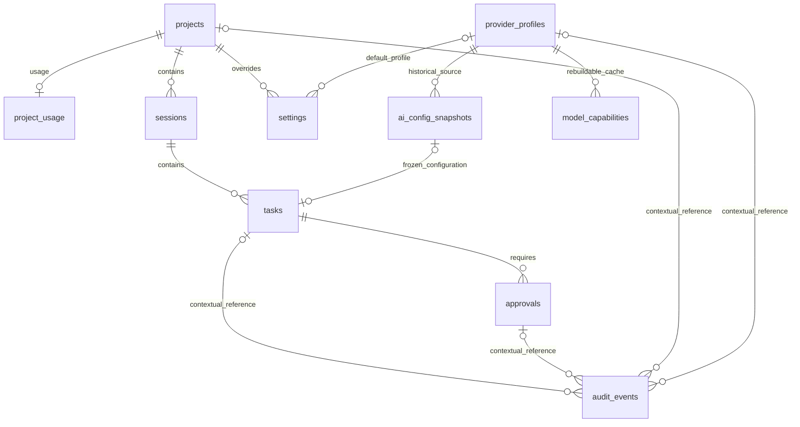

# 步骤 0.5：数据模型与留存初稿

日期：2026-10-11（Asia/Shanghai）。范围：schema v1 核心闭环，不是完整仓储。可执行字段见 `src-tauri/migrations/0001_initial.sql`，迁移实现见 `src-tauri/src/storage/`。按 [ADR-0011](self-managed-profile-adr.md) 采用自管 profile；既有迁移不修改，生产凭据和路由隔离仍待验收。

## 实体关系

每个任务属于一个会话；每个会话属于一个项目。任务在 `idle/preparing`、准备失败或运行前取消时可无快照；进入实际运行前必须在同一事务中写快照并绑定任务。存在 started_at 就必须有快照。一个快照最多关联一个任务，任务绑定后禁止更换或清空，快照禁止 UPDATE。准备失败/取消不强制虚构实际使用的配置。

## 通用字段约定

- 业务主键由服务层生成 UUID；外部会话/turn/request 标识另存，不能替代本地主键。
- 表使用 SQLite `STRICT`。时间统一为 UTC Unix 毫秒 INTEGER；UI 按本地时区显示。各表的创建/更新/开始/结束时间有基本大小约束。
- `NULL` 表示尚未产生或未指定，不等于空字符串。模型能力表的 `effort = ''` 专用于“不显式覆盖思考强度”；运行快照和默认值用 NULL。
- 状态、source、认证类型等 CHECK 限定枚举；模型名和发现的思考强度不写死，能力组合由服务层重新验证。
- 任意路径、endpoint、名称、摘要都是本地敏感元数据。没有保存原始 Key 的列并不表示整个库已加密，也不能靠 SQL CHECK 自动识别任意文本中的秘密。

## 字段级定义

下表列出完整业务字段组；NOT NULL、CHECK、主外键和索引详见 SQL，新增字段必须走迁移。

| 表 | 字段与含义 | 关系、索引与删除行为 |
| --- | --- | --- |
| projects | `id`；`canonical_path` 规范化绝对路径；`path_key` 平台去重键；`name` 目录名；可空 `display_name`；`created_at/updated_at` | `path_key` UNIQUE。会话存在时 RESTRICT 删除；用量及项目设置 CASCADE。Windows 路径比较按已验证的规范化/大小写规则生成键，其他平台独立策略；阶段 0.6/阶段一实现路径边界，阶段 0 不扫描磁盘。 |
| project_usage | `project_id` PK/FK；`last_opened_at`；非负 `open_count`；`last_source`：project_list/search/codex/system_open | 项目一对零或一；按最近打开时间 DESC 索引；项目删除时 CASCADE。统计可重置，不作为审计依据。 |
| sessions | `id`；`project_id`；可空 UNIQUE `external_session_id`；可空 `summary_redacted`（≤512 字符）；`status` active/closed/interrupted；`created_at/updated_at` | 项目+更新时间索引。任务存在时 RESTRICT。外部 ID 只作为相关引用；已验证的 ephemeral 会话不能凭该字段宣称支持重启恢复。 |
| tasks | `id`；`session_id`；可空 `external_turn_id`；可空 UNIQUE `snapshot_id`；可空 `prompt_summary_redacted/result_summary_redacted`（各≤512）；`status`；可空 `error_code`；`created_at`、可空 `started_at/finished_at` | 会话+创建时间、状态+创建时间索引；(session_id, external_turn_id) UNIQUE。状态采用计划枚举，另加 interrupted 表示本地重启发现的未决任务；终态必须有结束时间。审批存在时 RESTRICT。 |
| approvals | `id`；`task_id`；`external_request_id`；`operation_kind` command/file_change/unknown；可空 `operation_summary_redacted`（≤512）；`decision` pending/approved/denied/expired/interrupted；`requested_at`、可空 `decided_at` | (task_id, external_request_id) UNIQUE；任务+请求时间、pending 部分索引。pending 不得有决定时间，其余必须有。未知操作默认拒绝；重启后不重放历史批准。 |
| provider_profiles | `id/name`；`source_kind` official/relay；schema v1 `adapter_kind` self_managed/cc_switch；可空 `external_profile_id`；`endpoint/endpoint_origin`；`wire_api` responses；`auth_kind` api_key/external_login；`credential_ref/revision`；默认模型/强度、enabled、config_revision、时间 | 当前服务仅 self_managed，external_profile_id=NULL；cc_switch 历史/预留记录不可激活，不自动导入外部标识/Key。引用时 RESTRICT 删除，可 disabled；模型缓存 CASCADE；官方项仅预留。 |
| model_capabilities | `profile_id/model_id/effort` 复合 PK；可空正整数 `context_window`；`is_default`；`source_kind` cli_catalog/profile_declaration/connection_probe；`source_version`；`profile_revision`；`observed_at/expires_at` | 过期时间索引。按“一个模型+一个强度”一行，不用任意 JSON；NULL context 表示未知。来源版本及 profile revision 区分目录声明/真实探测；过期缓存不能保证远端可用。 |
| ai_config_snapshots | `id/profile_id/profile_name/source_kind`；endpoint/origin/协议/认证类型；凭据引用/版本；model/effort；config_revision；能力来源/版本、adapter_version；schema v1 routing_scope owned_process/shared_global；effective_at/captured_at | 当前任务只创建 owned_process，shared_global 历史/预留不能激活。profile 索引；UPDATE 触发器拒绝修改；任务仍引用时不可删除。冗余当时元数据保证历史不被 profile 编辑改写。 |
| settings | `id`；`scope` global/project；可空 `project_id`；allowlist `key`；可空 `value_text/value_integer`；AI 专用可空 `profile_id/model_id/effort`；`revision/updated_at` | global 每 key 唯一；project 每(project_id,key)唯一，两条部分 UNIQUE 索引解决 NULL 作用域去重。AI 默认值为结构化列，其他设置必须恰有一种值，不提供任意配置 JSON。 |
| audit_events | `id/occurred_at/correlation_id/event_kind/outcome`；可空 `error_code/project_id/task_id/approval_id/profile_id/model_id/effort` | 时间及 correlation 索引。上下文 FK 均 SET NULL，历史清理后仍保留最小事件、结果、关联 ID；无 prompt、命令、原始错误、自由文本 payload 或认证字段。 |
| schema_migrations | `version` INTEGER PK；`name/checksum/applied_at` | 内部迁移账本；SHA-256 以规范化 LF 的 SQL 计算，和 PRAGMA user_version 同事务提交；不是用户 setting。 |

普通设置 key：`search_engine/editor/project_sort/approval_policy/log_level/summary_retention_days`。这些值的具体类型、长度和允许值由阶段一类型化设置服务校验；不提供直接 SQL/任意 key 的 IPC。`editor` 仅保存可执行文件/已知编辑器标识，不保存拼接 Shell 字符串。凭据、网络 headers、环境变量对象和 Codex 原配置都不属于 settings。

schema v1 的 cc_switch/shared_global 枚举保留兼容与迁移校验和；生产仓储须按 ADR-0011 拒绝激活不支持记录并提示手动重建，不自动迁移外部凭据。数据库级收紧如需要只能追加迁移。

## 默认值与任务快照

有效选择顺序：本次显式选择 > 项目 `ai_defaults` 整组 > 全局 `ai_defaults` 整组 > 显式提示未配置。禁止从另一个 profile 的全局值拼出项目配置：组内 model 未指定时使用该 profile 的默认 model；effort 未指定时使用该 profile 的默认 effort/服务默认。替换 model 时，必须重新解析/验证强度，不沿用旧模型组合。没有有效模型/凭据则不能开始任务。

profile 默认值不是模型缓存的 FK，缓存可重建。执行前校验启用、修订、endpoint/origin、凭据和模型/强度，再事务绑定 task + snapshot。当前只允许 self_managed/owned_process，快照记录实际加载值；后续默认值切换只影响未来任务。环境/项目覆盖与共享可变代理拒绝按 ADR-0011/R-014 验证，不能靠 routing_scope 声称网络隔离。

`credential_ref` 只允许格式 `credential:<profile_id>:<credential_revision>`；它是凭据服务逻辑引用，不是 Key、Key 尾部、环境变量名、文件内容或 provider JSON。自管 Key 的实际值留在系统凭据库，凭据服务校验 profile ID、revision 和规范化 origin。换 Key 递增 credential_revision 与 config_revision；历史引用不保证可再次解析，删除凭据不使历史失效，也不能自动恢复/重放任务。脱敏显示仅用“已配置/待验证/失效”和元数据版本，避免保存完整 Key 或可推导片段。

数据库只对 endpoint 做基本 HTTPS、无 query/fragment/userinfo 检查；正式服务解析 URL、匹配 origin、防跨站重定向及敏感 path。系统凭据库、输入/日志脱敏和生产路由隔离属于阶段一实现，0.5 仅合成数据验证引用，不接收真实 Key、不访问 cc-switch 凭据。

## 留存与不保存范围

| 类别 | 数据 | 首版原则/期限初稿 |
| --- | --- | --- |
| 必须持久化 | 项目元数据、用量、设置、profile 元数据/引用、任务状态与时间、配置快照、审批决定、最小审计 | 项目/设置/profile 到用户删除；任务/会话/审批/快照元数据默认保留到用户清理；审计默认 90 天。删除历史按 approvals → tasks → snapshots → sessions 顺序事务处理，再按需要删除项目/设置/profile，审计上下文置空。 |
| 有条件保存 | 已脱敏会话、提示和结果/操作摘要 | 默认 NULL，只存必要短摘要；显式开启摘要历史后限 512 字符，默认 30 天，禁止复制完整提示、命令参数、文件内容和服务错误。清理策略在阶段一实现，当前未运行自动清理。 |
| 可重建缓存 | 模型能力、Git 状态/差异、路径存在性、索引搜索缓存 | model_capabilities 默认最多 24 小时，到期重探测；profile revision/adapter 版本变化立即失效。Git 和文件差异仅内存，首版不落本库。 |
| 明确不保存 | 完整 Key/token/password、auth/config 文件、cc-switch 数据库、原始 IPC/事件流、完整 prompt/模型回复、命令/文件正文、搜索词、项目文件副本 | 不进本库、普通日志、迁移备份、诊断或导出。关闭遥测；凭据库单独管理，不随普通库备份。 |
| 迁移备份 | 本库升级前一致性副本，含本地敏感路径/历史元数据 | 不含凭据 payload；同应用数据目录，只给当前用户/管理员既有访问范围。失败备份不自动删除；成功备份初稿保留最近 3 份且至少 7 天，后续清理需显式策略，本阶段不自动删除任何备份。 |

以上期限是阶段一实现依据，不是已实现的自动清理能力。日志/诊断留存和安全威胁测试由 0.6 完整定义；路径、摘要及模型名仍可能敏感，导出或跨设备备份需独立授权和加密设计。

## 重启与删除

重启读取本地记录不等于重启 Codex 会话。阶段一启动恢复服务应在事务中把非终态运行任务标为 interrupted、pending 审批标为 interrupted，记录 correlation ID 并提示重新发起；不自动重发 prompt、复用已批准命令或假定外部任务结束。仅本应用拥有的进程可管理。

数据库 FK 保证删除顺序，服务层还必须先阻止活跃任务/审批删除。需要保留被引用 profile 时仅 disable；用户要求删除关联历史时按依赖顺序事务清理。安全删除凭据通过凭据服务单独执行，不把凭据恢复作为数据库 restore 的副作用。
